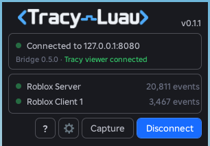
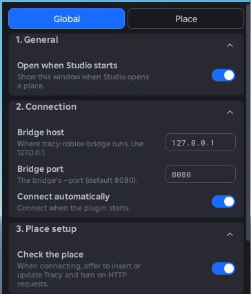

<h1 align="center">
  <picture>
    <source media="(prefers-color-scheme: dark)" srcset="assets/logo-light.png">
    
  </picture>
  <br>
  Studio Plugin
</h1>

A Roblox Studio plugin for [Tracy-Luau](https://github.com/JustChooseAndrew/tracy-luau).
It connects to `tracy-roblox-bridge`, shows what's streaming, sets places up, and takes
MicroProfiler captures with one click. Tracy-Luau works without it; the plugin just
saves you the setup.

<p align="center">
  
  &nbsp;
  
</p>

## Usage

Install it from the
[Creator Store](https://create.roblox.com/store/asset/120313821857622).

1. Start `tracy-roblox-bridge`, and connect the Tracy viewer to `127.0.0.1`.
2. Open the plugin from the Plugins tab and press **Connect**.
3. Press Play.

Once connected, the plugin shows:
- **The bridge and viewer.** Whether the bridge is up and the Tracy viewer is attached,
  with a live list of tracks (`Roblox Server`, `Roblox Client 1`, ...) and their event
  counts.
- **The place's setup.** It offers to insert or update the Tracy module, turn on Allow
  HTTP Requests, and point the place at your bridge's port. It always asks first, and
  every change can be undone.
- **Capture.** During a playtest, one click saves the last frames of the MicroProfiler,
  engine work included, as a `.tracy` file next to the bridge. It needs
  [LibMP](https://github.com/Roblox/libmp) in ReplicatedStorage or ServerStorage.

**Settings → Place** switches the Tracy module's streaming, MicroProfiler mode and
built-in plots for the open place. They're saved with the place, as attributes on
`ReplicatedStorage.Tracy`.

## Building

```powershell
rojo build default.project.json --plugin TracyLuau.rbxm
```

- `python tools/sync_module.py` copies the Tracy module the plugin installs from a
  Tracy-Luau checkout next to this one.
- `python tools/make_assets.py` rebuilds the images in `assets/` from the logo artwork.
- Lint with `stylua --check src` and `selene src`.

## Credits

Created by [JustChooseAndrew](https://github.com/JustChooseAndrew), and built alongside
[ABC2gameYT](https://github.com/ABC2gameYT).

Tracy-Luau Plugin is MIT licensed. It's an independent project, not affiliated with or
endorsed by Roblox, the Luau team, or the Tracy project. Luau is a trademark of Roblox
Corporation.

## AI transparency

Tracy-Luau's architecture was built by andrewdecker1, with development help, testing,
and bug fixing by Claude, Anthropic's AI assistant.
